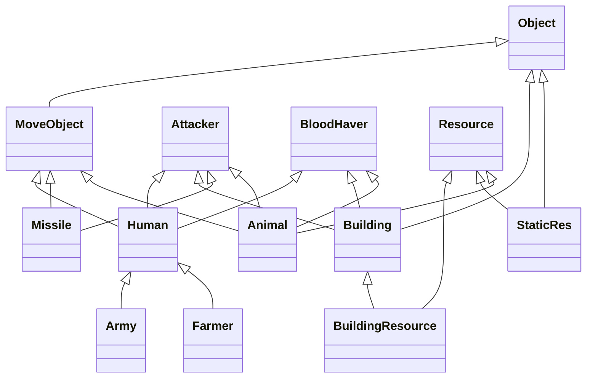

# BaseObject 模块说明

> 本文档描述 `Server/core/BaseObject/` 下各类的职责、继承关系与关键机制，用于接手/评审时快速定位。
> 内容与当前代码（`feature/player`，提交 `5632a79`）一致，不含推测。

---

## 1. 模块定位

`BaseObject` 描述「场景里一切有位置的东西」：单位、建筑、投掷物、野生动物、静态资源。

**负责：** 对象自身的状态与数值（位置、归属、名称、视野、血量、攻防、可采集资源、碰撞盒）。

**不负责：**

| 事项 | 归属 |
|---|---|
| 每帧驱动、AI、指令 | 内核 / Instruction |
| 寻路 | 外部算好路径，`MoveObject::setPath` 只接收 |
| 对象的创建登记与销毁 | `Player`（`newXXX` / `removeXXX`） |
| 科技的具体内容 | `Development`（本模块只通过 `WeakPtr` 读加成） |
| 基础数值 | `Public/config/ObjectBaseValue.h` |

依赖方向：

```
Player ──创建/登记──▶ BaseObject ──读加成──▶ Development
                          └──读基础值──▶ ObjectBaseValue
```

`BaseObject` **单向依赖** `Development` 与数值表，不会反向调用 `Player`。
（`Object.cpp` 里还留着 `#include "Server/core/Module/Player/Player.h"`，但已经没有任何地方用到，属可清理的残留。）

---

## 2. 文件清单

| 文件 | 角色 |
|---|---|
| `Object.h/.cpp` | 所有对象的根，放位置/归属/SN/碰撞盒 |
| `MoveObject.h/.cpp` | mixin：可移动（速度 + 路径） |
| `Attacker.h/.cpp` | mixin：可攻击（攻/防类型、射程、出手帧） |
| `BloodHaver.h/.cpp` | mixin：有血量与防御 |
| `Resource.h/.cpp` | mixin：可作为资源被采集 |
| `Human.h/.cpp` | 会移动的人形单位（军队 + 农民船只的公共父类） |
| `Army.h/.cpp` | 军队单位，带 `armyClass` 兵种大类 |
| `Farmer.h/.cpp` | 农民 / 渔船 / 商船 / 运输船，带背包 |
| `Building.h/.cpp` | 建筑，血量按建造进度折算 |
| `BuildingResource.h/.cpp` | 资源型建筑（农田），可采集 |
| `Missile.h/.cpp` | 投掷物（箭、矛、石） |
| `Animal.h/.cpp` | 野生动物 / 树，死后可采 |
| `StaticResource.h/.cpp` | 浆果丛、石矿、金矿、鱼群 |
| `CrashBox.h/.cpp` | 圆 / 矩形碰撞盒（纯几何，不含对象语义） |
| `SafePointer.hpp` / `WeakPointer.hpp` | 引用计数与弱引用 |
| `Block.h` | 地块结构体（地图用，与对象无关） |

---

## 3. 继承结构



`Attacker` / `BloodHaver` / `Resource` / `MoveObject` 中，前三个是无基类的 **mixin**（只提供数据与默认实现），
`MoveObject` 才是 `Object` 的派生类。

### 能力矩阵

| 类 | 移动 | 血量 | 攻击 | 可作为资源被采 | 直接父类 |
|---|:--:|:--:|:--:|:--:|---|
| `Object` | – | – | – | – | 无（根） |
| `MoveObject` | ✓ | – | – | – | Object |
| `Human` | ✓ | ✓ | ✓ | – | MoveObject + BloodHaver + Attacker |
| `Army` | ✓ | ✓ | ✓ | – | Human |
| `Farmer` | ✓ | ✓ | ✓ | – | Human |
| `Missile` | ✓ | – | ✓ | – | MoveObject + Attacker |
| `Building` | – | ✓ | ✓ | – | Object + BloodHaver + Attacker |
| `BuildingResource` | – | ✓ | ✓ | ✓ | Building + Resource |
| `StaticRes` | – | – | – | ✓ | Object + Resource |
| `Animal` | ✓ | ✓ | ✓ | ✓ | MoveObject + Resource + BloodHaver + Attacker |

两个值得注意的「不做」：

- `Missile` **不继承** `BloodHaver`：投掷物不会被打死，靠命中或超时销毁。
- `Farmer` **不继承** `Resource`：它是采集者，背包字段（`resource` / `resourceMax`）是它自己的，与 `Resource` 的 `cntLeft` 无关。

---

## 4. `Object`：根类

### 字段

| 字段 | 说明 |
|---|---|
| `playerID` / `teamID` | 归属玩家与团队；中立对象为 `-1` |
| `sort` / `type` | 大类（`SORT_*`）与具体类型（`AT_*` / `BUILDING_*` / `FARMERTYPE_*` …） |
| `SN` | 全局唯一编号，`globalSNIndex` 从 1 递增 |
| `name` | 名称，派生类用 `ObjectBaseValue::getObjectName` 填 |
| `detail_pos` / `block_pos` | 细节坐标 / 区块坐标 |
| `vision` | 视野（区块） |
| `crashBoxRect` / `crashBoxCircle` | 匿名 union，碰撞盒 |

### 重要约定：`Object` 的构造函数**什么都不初始化**

```cpp
Object::Object(){SN=globalSNIndex++;}   // 只分配 SN
```

`sort` / `type` / `playerID` / `teamID` / `name` / `vision` / `detail_pos` / `block_pos` / `crashBox`
**全部由派生类负责**。这是刻意设计（基类不知道派生类的语义），代价是每个派生类构造函数都必须写全：
漏掉任何一个字段，读到的是随机内存。

写新派生类时按这个顺序：

1. `sort`、`type` 先定（后续查表都依赖它们）
2. `detail_pos` / `block_pos`（或用 `setPos`）
3. `playerID` / `teamID`（中立填 -1）
4. `name`、`vision`（走 `ObjectBaseValue`）
5. 血量/攻防/速度（直接写，或调 `refresh()`）
6. `rebuildCrashBox()`

### 坐标

- `detail_pos` 是细节坐标，`block_pos = detail_pos / BLOCKSIDELENGTH`（`BLOCKSIDELENGTH = 1000`）。
- `setPos()` 会同时更新两者，并**重建碰撞盒**，所以调用前 `sort` / `type` 必须已经就位。
- `Human` 的构造函数里先 `setPos` 后定 `type`，此时 `type` 还没有赋值（`Object` 不初始化它）。
  这一次建盒会走到 `getCrashBox` 的越界分支，拿到半径 0 的空盒；`Army` / `Farmer` 在末尾会再调一次
  `rebuildCrashBox()` 覆盖掉，所以最终结果正确，但读未初始化的 `type` 严格说是未定义行为。
  调整构造顺序（先定 `sort`/`type` 再 `setPos`）可以顺带消掉这个隐患。

### 碰撞盒

```cpp
union{ CrashBox_Rect crashBoxRect; CrashBox_Circle crashBoxCircle; };
```

`union` 本身**不记录**当前存的是圆还是矩形，所以：

- `rebuildCrashBox()` 一律按 `ObjectBaseValue::getCrashBox(sort,type)` 的口径 placement new；
- `checkCrash()` 也是先查表判断双方形状，再调用对应的 `IsCrash`。

**改碰撞盒数据表时，形状（圆/矩形）和尺寸要一起改**，否则联合体里的内容与判定口径会错位。
尺寸为 0 的碰撞盒按 `CrashBox` 的约定永远不参与碰撞。

### `changeType`

```cpp
void Object::changeType(I32 newType);   // sort 不变，只换 type
```

升级（棍棒兵→刀斧兵、瞭望塔→警戒塔）的统一入口：换 `type` → 重设名称/视野 → `refresh()` → 重建碰撞盒。
由 `Player::changeObjectType` 调用。

### 重复接口

`getSN()` 与 `getglobalNum()` 实现完全相同（都返回 `SN`），属历史遗留，保留是为了不破坏已有调用点。

---

## 5. 四个 mixin

### `MoveObject`

| 成员 | 说明 |
|---|---|
| `speed` | 速度，单位「细节坐标 / 秒」，按帧用需 `/ GAME_TPS` |
| `path` | `stack<IVec2>`，栈顶是下一个落脚点 |
| `targetDetailPos` | 最终目标点 |

- `nextPos()`：栈非空则弹出栈顶，否则返回 `targetDetailPos`。
- `setPath()`：拷贝路径时如果栈顶就等于当前位置，先弹掉（避免原地停一帧）。
- `getSpeed()` / `refreshSpeed()` 是虚函数，由带科技的对象覆写。

### `Attacker`

| 成员 | 说明 |
|---|---|
| `attackClose` / `attackShoot` | 近战 / 远程伤害（已含科技加成） |
| `attackType` | `ATTACKTYPE_CLOSE` / `ATTACKTYPE_SHOOT`，决定用哪一个 |
| `range` / `rangeEffect` | 是否范围伤害 / 溅射半径（区块） |
| `minAttackRange` | 攻击距离（区块） |
| `attackCircle` | 从出手到真正造成伤害要经过的帧数 |
| `attackCurrentTick` | 当前进行到第几帧 |
| `attackInteval` | 攻击间隔（帧） |

- 构造函数把 9 个字段全部清零（`attackCircle` 取 `ATTACK_CIRCLE_FRAMES`），避免派生类构造顺序里读到随机值。
- `getAttack() = getAttackBasic() + getAttackAdditon()`。
  `Basic` 是数值表里的基础值，`Additon` 是「当前值 − 基础值」，两个都给是为了 UI 显示「基础 + 科技」。
- `notifyHit()` 是命中钩子，默认空实现。

### `BloodHaver`

| 成员 | 说明 |
|---|---|
| `maxBlood` / `currentBlood` | 血量上限 / 当前血量 |
| `defenceClose` / `defenceShoot` | 近战 / 远程防御 |

- `getMaxBlood()` / `getBlood()` 是**虚函数**：`Building` 覆写它们做建造进度折算。
- `isDie()` 判的是 `getBlood() <= 0`（走虚函数，建筑施工期按折算值判断）。
- `beHeal()` 对已经死亡的对象无效 —— 不能靠治疗复活。
- `beAttcked(damage)` 里的 `damage` **已经扣过防御**，这里只做减血 + 夹到 0 + 调 `notifyAttacked()`。
- `notifyAttacked()` 是钩子：动物靠它在死时打开 `gatherAble`，其它逻辑（打断采集、拉仇恨）也可以挂这里。
- 默认 `refreshBlood()` / `refreshDefence()` 是空实现，给没有科技的对象用。

### `Resource`

| 成员 | 说明 |
|---|---|
| `cntLeft` / `maxCnt` | 剩余量 / 上限 |
| `decayRate` | 每帧腐烂量（静态资源为 0） |
| `resourceSort` | 采出来是什么资源（`PRODUCTSORT_*`） |
| `gatherAble` | 是否可采集 |

- `reduceResource(amount)`：扣量并夹到 0；**扣到 0 时自动把 `gatherAble` 关掉**。
- `decayResource()` 就是 `reduceResource(decayRate)`。
- `isGatherAble()` 是虚函数，语义是「现在能不能采」：静态资源恒可采、动物死后才可、农田要建成。

> 注意：`reduceResource` 在扣空时直接把 `gatherAble=false`，这对「尸体被采光」是正确的，
> 但如果某个类需要「采空后仍然可交互」，要自己覆写。

---

## 6. 具体类

### `Human`（军队与农民船只的公共父类）

| 成员 | 说明 |
|---|---|
| `playerScience` | `WeakPtr<Development>`，本单位的科技来源 |
| `transported` | 是否正被运输 |
| `getArmyClass()` | 兵种大类，虚函数；默认返回 `-1`（经济单位），`Army` 覆写 |

`refresh()` 依次调用 `refreshBlood()` → `refreshDefence()` → `refreshSpeed()` → `refreshAttack()`。
**顺序有意义**：后面三个都以「当前血量 > 0」为前提（见 7.1）。

### `Army`

- `type` 保持 `AT_*` 不变（数值表按它检索），另设 `armyClass` 存大类：
  `ARMY_INFANTRY` / `ARMY_ARCHER` / `ARMY_RIDER` / `ARMY_FLAMEN` / `ARMY_SIEGE` / `ARMY_SHIP`。
- 科技按大类给加成时用 `armyClass`，按具体兵种给数值时用 `type`。
- 构造函数末尾调 `Human::refresh()` 把血量/攻防/速度按当前科技填好，再建碰撞盒。

### `Farmer`

| 成员 | 说明 |
|---|---|
| `resource` / `resourceMax` | 当前背包 / 基础携带量 |
| `resourceSort` | 当前在采的资源类型，出生为 `-1` |
| `quantity_GatherOnce` | 一次采集量，出生为 0，等采集指令设定 |
| `humanTransport` | 运输的乘客（`SafePtr<Human>`） |

- `getResourceHaveMax() = resourceMax + getResourceHaveAddition()`，加成来自 `Development::get_addition_ResourceCarry(resourceSort)`，**每次现算，不缓存**，科技一变上限跟着变。
- `addResource(qty, sort)`：**资源类型变化时先清空背包**，再按新类型的上限累加。
  （旧实现是直接 `return`，农民一旦换资源就永远采不进去。）
- `getTransportMax()`：小型运输船 5 / 重型运输船 10 / 其它 0。

### `Building`

| 成员 | 说明 |
|---|---|
| `fundation` | 地基类型（小/中/大/巨大），按 `type` 在构造时判定 |
| `Percent` | 建造进度 0~100 |
| `constructed` | 建成标志（由 `isConstructed()` 惰性置位） |

**血量语义（重点）**

- 内部的 `maxBlood` / `currentBlood` **永远存 100% 的满血值**，建造进度不进字段。
- 对外读取时折算：
  - `getMaxBlood()`：建成返回 `maxBlood`；施工中返回 `maxBlood × Percent / 100`，且**保底 1 点**（进度 0 的建筑不能一落地就死）。
  - `getBlood()`：建成返回 `currentBlood`；施工中返回 `getMaxBlood() - (maxBlood - currentBlood)`，即保持「已损失量」不变。
- `build(percent)` 是**累加**的（传本次推进量），上限截到 100 并把 `constructed` 置真。
- 因为内部一直是满血，`build(100)` 之后读数自动变满血 —— 完工即满血，不需要额外处理。

**注意：** `isConstructed()` 用 `Percent >= 100` 判定，`constructed` 只是缓存。
新建对象一律走 `Percent` 判断更可靠（`BuildingResource::isGatherAble` 就是这么做的）。

`isMatchResourceType(productSort)`：市镇中心接受一切，谷仓只收食物，仓库收食物/木/石/金。

### `BuildingResource`（农田）

- 构造时先把 `sort` 改成 `SORT_BUILDING_RESOURCE`。
- 资源量 `cntLeft = getMaxCnt(science)`，**在构造时按当时的科技定格**：之后研究「灌溉」不会让已建成的农田变多，只有新农田吃加成。
- `isGatherAble()`：`!isConstructed()` 直接不可采；建成后看 `gatherAble`（采空会被 `reduceResource` 关掉）。

### `Missile`

- 只有 `MoveObject + Attacker`，没有血量。
- `attacker` / `attackee` 用 `WeakPtr` 保存，取位置前先 `lock()` 判空（目标可能在同一帧被删）。
- 初始位置取攻击者位置，目标点取被攻击者位置。
- `range = (type == Missile_Boulders)` —— 只有巨石带溅射。
- 攻击力由构造函数参数传入（发射时就定了），之后不再随科技变化。

### `Animal`

- 中立：`playerID = teamID = -1`，`friendly` 区分敌对（狮子、鳄鱼）与中立。
- 数值全部在构造函数里按 `ObjectBaseValue` 填好（没有科技，不走 `refresh`）。
- `gatherAble` 初始为 `false`；`notifyAttacked()` 里一旦 `isDie()` 就置 `true` —— **尸体才能采**。
- `resourceSort`：树 → 木材，其余 → 仓库食物。

### `StaticRes`

- 中立，恒可采（`gatherAble = true`），不腐烂。
- `resourceSort` 按类型映射到 `PRODUCTSORT_STOCKFOOD / STONE / GOLD`。

---

## 7. 关键机制

### 7.1 科技刷新管线

调用 `refresh()` 的时机：

| 时机 | 调用点 |
|---|---|
| 对象出生 | `Army` / `Farmer` / `Building` 构造函数末尾 |
| 科技/解锁动作完成 | `Player::refreshAllObjectScience()` |
| 类型升级 | `Object::changeType()` |

`Human::refresh()` 的四步顺序不能乱：

```
refreshBlood() → refreshDefence() → refreshSpeed() → refreshAttack()
```

因为后三个都有 `if(science == nullptr || isDie()) return;` 的前置判断，
而新单位出生时 `currentBlood` 是 0 —— 如果 `refreshBlood` 也被 `isDie()` 拦住，
就会永远停在 0 血，四个刷新全部失效（这条曾经是一个真实 bug）。

`refreshBlood()` 分三种情况：

| 情况 | 判定 | 行为 |
|---|---|---|
| 首次刷新 | `maxBlood <= 0` | 上限与当前血量都设成满血 |
| 已死亡 | `currentBlood <= 0` 且 `maxBlood > 0` | 只更新上限，**不复活** |
| 残血 | 其它 | 上限涨多少当前涨多少（缺口不变），并夹到 `[0, maxBlood]` |

公式统一为：

```
新值 = 基础值(数值表) × 比例加成(Development) + 数值加成(Development)
```

**科技为空时按基础值算**（比例 1、加成 0），不是直接返回。
否则 `maxBlood` 停在 0、`isDie()` 恒真，四个刷新会连锁失效 —— 单位一出生就是死的。
目前 `Human` / `Building` 的四个 refresh 都按这个口径处理。

### 7.2 攻击 / 防御的「基础 + 加成」拆分

`Human` / `Building` 覆写了 6 个 getter：

| 接口 | 返回 |
|---|---|
| `getAttackBasic()` | 数值表里的基础攻击（按 `attackType` 取近战或远程） |
| `getAttackAdditon()` | `当前攻击 - 基础攻击` |
| `getDefenceCloseBasic()` / `getDefenceShootBasic()` | 数值表里的近战 / 远程防御 |
| `getDefenceCloseAddition()` / `getDefenceShootAddition()` | `当前防御 - 基础防御` |

`getAttack()` 仍等于「基础 + 加成」，也就是最终值，不会重复计算。
`Animal` / `Missile` 用默认实现（Basic 直接返回内部值、Addition 恒 0），因为它们的数值本来就不含科技。

**无攻击单位不能被「凭空加成」**：基础攻击为 0（祭司、渔船、投石兵没有近战）时，
`refreshAttack()` 直接把对应字段置 0，不套科技加成 —— 否则会出现祭司能砍人、投石兵贴身比远程还疼。

防御**不能**用同样的「基础 0 跳过」办法（棍棒兵基础护甲本来就是 0），
所以经济单位靠 `getArmyClass()` 返回 `-1` 来避免吃到步兵护甲加成。

### 7.3 资源采集的三方语义

| 角色 | 类 | 语义 |
|---|---|---|
| 采集者 | `Farmer` | 有背包（`resource`），不继承 `Resource` |
| 可采对象 | `StaticRes` / `Animal` / `BuildingResource` | 继承 `Resource`，有 `cntLeft` |
| 判断 | `Resource::isGatherAble()` | 静态资源恒可、动物死后可、农田建成后可 |

`Resource::reduceResource()` 在采空时关掉 `gatherAble`，采集方据此换目标。

### 7.4 投掷物的速度

`Missile` 不走 `UnitValue` 表（那里只有兵种/农民/动物），速度单独来自
`ObjectBaseValue::MissileSpeed[NUMBER_MISSILE]`（数据表没有这一列，按「越重的弹道越慢」估的）。
早期漏了这张表，`getBasicSpeed(SORT_MISSILE, …)` 恒返回 0，投掷物会停在发射点。

### 7.5 名称 / 视野 / 碰撞盒的统一来源

三者都来自 `ObjectBaseValue`：

```cpp
name   = ObjectBaseValue::getObjectName(sort, type);
vision = ObjectBaseValue::getBasicVision(sort, type);
rebuildCrashBox();   // 内部查 getCrashBox(sort, type)
```

`Object::changeType()` 会把这三样一起刷新，所以升级后不需要额外处理。

**数值口径**（写在 `ObjectBaseValue.h` 头部）：

- 速度：细节坐标 / 秒（表里 1.1 区块/秒 → 1100），按帧用再 `/ GAME_TPS`
- 攻击间隔：帧
- 攻击距离 / 溅射半径：区块
- 碰撞盒尺寸：细节坐标

---

## 8. 所有权与生命周期

- 容器与外部都用 `SafePtr`（引用计数）；`destroy()` 之后 `operator->` 返回 `nullptr`，`IsNull()` 为真。
- `Development`、投掷物的攻击者/目标都用 `WeakPtr`，不延长对方生命周期。
- `Farmer::humanTransport` 用 `SafePtr<Human>` 保存乘客，属强引用：乘客 `destroy()` 后访问是安全的（拿到 `nullptr`），但内存要等这一份也释放。
- `Object` **没有虚析构**。当前所有成员都是 POD、没有堆资源，实际不会泄漏；但如果以后给派生类加堆成员，必须补 `virtual ~Object()`。

---

## 9. 已知问题 / 待办

| # | 问题 | 位置 |
|---|---|---|
| 1 | `Development::get_speed_attack` 尚未实现，`Human.cpp` / `Building.cpp` 现在**编译不过**，等科技模块合入 | `Human.cpp:149-150`、`Building.cpp:191-192` |
| 2 | `Double` 的乘除目前恒为 0（`Fixed<I64,I64,32>` 中间值溢出，库级问题），所有 `基础值 × 比例` 都会算成 0。坐标换算已改用整数（`BLOCK_SIDE_DETAIL`）绕开，但伤害/血量仍受影响 | `Server/core/type.h` |
| 3 | `StaticRes` 的 `rebuildCrashBox()` 被注释掉，`crashBox` 未初始化，参与碰撞会读到垃圾 | `StaticResource.cpp` |
| 4 | `BuildingResource` 构造时 `sort` 还是 `SORT_BUILDING`，防御按建筑表算，改 `sort` 后没有重算 | `BuildingResource.cpp` |
| 5 | `Human::refresh()` 里保留了一大段注释掉的旧实现（约 60 行），可清理 | `Human.cpp` |
| 6 | `Object.cpp` include 了 `Player.h` 但没使用 | `Object.cpp` |
| 7 | `getSN()` 与 `getglobalNum()` 完全重复 | `Object.h` |
| 8 | ~~`Object` 缺虚析构~~ —— 已补 `virtual ~Object() = default;` | `Object.h` |
| 9 | 单位改造/建筑类型的槽位划分见 `Player.md`，本模块只保证 `changeType` 能正确响应 | — |
| 10 | `Human` 构造里 `setPos` 早于 `type` 赋值，那一次建盒读到未初始化的 `type`（越界 → 空盒，随后被派生类覆盖） | `Human.cpp` |

---

## 10. 改这个模块时的检查清单

- [ ] 新派生类是否自己填了 `sort` / `type` / `playerID` / `teamID` / `name` / `vision` / 位置 / 碰撞盒？（`Object` 一个都不填）
- [ ] 新增成员是否在构造函数里清零？（构造顺序里读到随机内存是最难查的一类 bug）
- [ ] 数值单位是否遵守「速度=细节坐标/秒、间隔=帧、射程=区块」？
- [ ] 是否引入了 `double` / `float`？（跨平台一致性要求，一律用 `Double`）
- [ ] 改碰撞盒表时，形状与尺寸是否一起改了？
- [ ] 改动 `refresh()` 的子步骤顺序了吗？`refreshBlood` 必须最先跑。
- [ ] 新增「可被采集」的类，是否想清楚了 `gatherAble` 的初始值与关闭时机？
